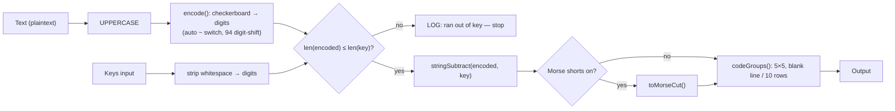

# Silent Duck — Single web page HTML with Javascript

> **Author:** Robert Hartley

---

## 1. Purpose

`sd.html` is a **single-file, offline, browser-based** one-time pad (OTP)
cipher. It re-implements the Silent Duck procedure from [otp.py](../otp.py) in
plain JavaScript so it can be opened directly from disk — no server, no build
step, no dependencies — and used as a **teaching artefact**.

The page deliberately follows the house style of
[trifid.html](trifid.html):

- **All HTML markup sits at the top** of the file.
- **A single `<script>` block sits below it.**
- The JavaScript is written in a plain, procedural, **"old C programmer"**
  idiom — short named functions, explicit loops, lookup tables built once at
  load, and a visible logging pane — so a reader can follow the data flow
  line by line.

`sd.html` is a **cipher** plus a **key-book generator**. The operator supplies
both the message text and the key material for enciphering/deciphering; key
books can be generated from the browser's CSPRNG and downloaded as a text file
(see [§11](#11-key-generation)).

## 2. Model: what we copy from `otp.py`

The cryptographic behaviour is a faithful port of these pieces of
[otp.py](../otp.py):

| otp.py element | Role in sd.html |
| --- | --- |
| `encode()` / `decode()` | Straddling-checkerboard conversion between text and digits. |
| `stringSubtract()` | Enciphering step: `cipher = encoded − key` (mod 10, per digit). |
| `stringAdd()` | Deciphering step: `clear = cipher + key` (mod 10, per digit). |
| `insertAlphabetSwitches()` | Auto-inserts the `~` Roman/Cyrillic switch. |
| `toMorseCut()` / `fromMorseCut()` | Optional Morse "cut number" shorts. |
| `codeGroups()` | Output layout: 5×5 groups, blank line every 10 lines. |
| the `len(a) > len(b)` guard inside `stringSubtract()`/`stringAdd()` | The **"ran out of key"** test. |

### 2.1 Confirmed design decisions

These five points were agreed before drafting and are binding on the build:

1. **Alphabet scope — Roman + Cyrillic (full `otp.py` parity).** Includes the
   `~` → `99` alphabet-switch control code.
2. **Decipher output — decode fully to readable plaintext.** Deciphering runs
   all the way back through `decode()`, not merely to recovered digits.
3. **Whitespace — stripped from the ciphertext and key inputs only.** Plaintext
   spaces are **preserved**, because a space is a real encoded character
   (`98`); stripping it would corrupt the message.
4. **Encoding parity — exact.** Single-digit high-frequency letters
   `A E N R O I T`, the `94` digit-shift, and the punctuation codes
   `? : @ / ~ # . ,` plus space and newline all match `otp.py` exactly.
5. **Output + errors — two read-only panes.** A read-only *Output* textarea for
   results and a separate *Log/Status* textarea (trifid-style) for messages
   such as "ran out of key" or "invalid character".

### 2.2 Enciphering convention (kept deliberately)

Silent Duck enciphers by **subtracting** the key from the encoded message
(`cipher = encoded − key`) and deciphers by **adding** it back
(`clear = cipher + key`). This is the reverse of many textbook OTP examples and
is kept on purpose: prefixing a message with `AAAAA` encodes to `00000`, so the
first output group becomes a plain copy of the first key block — an easy,
built-in way to **confirm the correct key page** is in use. Keeping the exact
convention preserves that trick for students.

## 3. User interface

The page presents the following widgets, in order down the page:

1. **Text** — a multi-line input. Holds the **plaintext** when enciphering and
   the **ciphertext** when deciphering. (One widget, reused by both buttons.)
2. **Keys** — a multi-line input. Holds the OTP **key digits** (the contents of
   one or more `.otk` sheets, pasted in).
3. **Morse shorts** — a toggle (checkbox). When on, ciphertext is written and
   read as Morse "cut number" letters instead of bare digits. It affects
   **ciphertext only, on both input and output**; the **key is always plain
   digits** regardless of this toggle.
4. **Encipher** — button. Plaintext → ciphertext.
5. **Decipher** — button. Ciphertext → plaintext.
6. **Output** — read-only multi-line area for the result.
7. **Log / Status** — read-only multi-line area for errors and notes.

Below these, a separate **Key Generation** section ([§11](#11-key-generation)):

8. **Digits per group**, **Groups per line**, **Lines per page**,
   **Pages per book**, **Generations** — whole-number inputs.
9. **Generate & Download** — button. Builds the key book and downloads it.
10. **Key Generation Log** — read-only area for the run's parameters, start,
    stop and elapsed time, filename, or an error.

The cipher side does no file I/O — material is pasted in and results are read
out. The only file I/O on the page is the key-book download.

## 4. Processing pipelines

### 4.1 Encipher



Order of operations, matching the spec "before enciphering, internally there
will be an encoding and a test to see if we have run out of keys":

1. Take the **Text** field as plaintext. Do **not** strip its whitespace.
2. Upper-case it and run `encode()` to produce the digit stream (this inserts
   `~`/`99` alphabet switches and `94` digit-shifts automatically).
3. Take the **Keys** field, **strip all whitespace**, keep digits only.
4. **Key-exhaustion test:** if the encoded digit stream is longer than the
   available key, write a clear message to the Log and **produce no output**.
5. Otherwise `stringSubtract(encoded, key)` to get the ciphertext digits.
6. If **Morse shorts** is on, map digits → cut letters with `toMorseCut()`.
7. Lay the result out with `codeGroups()` and write it to **Output**.

### 4.2 Decipher

1. Take the **Text** field as ciphertext and **strip all whitespace**.
2. If **Morse shorts** is on, map cut letters → digits with `fromMorseCut()`;
   otherwise keep digits only.
3. Take the **Keys** field, strip whitespace, keep digits.
4. **Key-exhaustion test:** if the ciphertext is longer than the key, log and
   stop.
5. `stringAdd(cipher, key)` to recover the encoded digit stream.
6. `decode()` back to **readable plaintext** (Roman/Cyrillic, punctuation,
   digit runs) and write it to **Output**.

## 5. The straddling checkerboard

High-frequency letters cost a single digit; everything else costs two. Two
reserved codes carry structure rather than letters: **`94` = digit-shift**
(`#`), **`99` = alphabet-switch** (`~`). Inside a digit run each digit is
**doubled** (`1` → `11`) and the run is bracketed by `94`.

### 5.1 Roman table

| Code | | Code | | Code | | Code | |
| --- | --- | --- | --- | --- | --- | --- | --- |
| `0` | A | `70` | B | `80` | P | `90` | ? |
| `1` | E | `71` | C | `81` | Q | `91` | : |
| `2` | N | `72` | G | `82` | S | `92` | @ |
| `3` | R | `73` | D | `83` | U | `93` | / |
| `4` | O | `74` | F | `84` | V | `94` | `#` digit-shift |
| `5` | I | `75` | H | `85` | W | `95` | . |
| `6` | T | `76` | J | `86` | X | `96` | , |
| | | `77` | K | `87` | Y | `97` | ⏎ newline |
| | | `78` | L | `88` | Z | `98` | ␠ space |
| | | `79` | M | `89` | *(reserved)* | `99` | `~` alphabet-switch |

### 5.2 Cyrillic table

| Code | | Code | | Code | | Code | |
| --- | --- | --- | --- | --- | --- | --- | --- |
| `0` | А | `70` | Б | `80` | П | `90` | Ь |
| `1` | Е | `71` | В | `81` | Р | `91` | Э |
| `2` | И | `72` | Г | `82` | У | `92` | Ю |
| `3` | Н | `73` | Д | `83` | Ф | `93` | Я |
| `4` | О | `74` | Ж | `84` | Х | `94` | `#` digit-shift |
| `5` | С | `75` | З | `85` | Ц | `95` | . |
| `6` | Т | `76` | Й | `86` | Ч | `96` | , |
| | | `77` | К | `87` | Ш | `97` | ⏎ newline |
| | | `78` | Л | `88` | Щ | `98` | ␠ space |
| | | `79` | М | `89` | Ы | `99` | `~` alphabet-switch |

The shared codes (`94`–`99`) are identical across both alphabets, so punctuation
and digit runs behave the same regardless of which alphabet is active.

## 6. Morse "cut number" shorts

When the toggle is on, each ciphertext digit is swapped for a short Morse
"cut" letter that is faster to send by key, and reversed on the way in:

| Digit | 0 | 1 | 2 | 3 | 4 | 5 | 6 | 7 | 8 | 9 |
| --- | --- | --- | --- | --- | --- | --- | --- | --- | --- | --- |
| Cut | T | A | U | V | 4 | E | 6 | B | D | N |

This is a straight character-for-character substitution over the ciphertext
only; it never touches the key and never changes message length.

## 7. Output layout

`codeGroups()` renders the ciphertext as **five digits per group, five groups
per line**, with a **blank line after every ten lines** — the same page shape
as [otp.py](../otp.py) (`DIGITSPERGROUP=5`, `GROUPSPERLINE=5`, `LINESPERPAGE=10`).
The decipher result, by contrast, is free-running readable plaintext.

## 8. Whitespace rules (summary)

| Field | On encipher | On decipher |
| --- | --- | --- |
| **Text** | plaintext — whitespace **preserved** | ciphertext — whitespace **stripped** |
| **Keys** | whitespace **stripped**, digits only | whitespace **stripped**, digits only |

Stripping lets the operator paste neatly grouped key pages and grouped
ciphertext without hand-trimming, while protecting the meaningful spaces inside
a plaintext message.

## 9. Error handling

All failures are reported to the **Log / Status** pane rather than aborting
(the browser equivalent of `otp.py`'s `die()`), and no partial result is
written to **Output**. The two expected conditions are:

- **Ran out of key** — encoded/ciphertext length exceeds the key length.
- **Invalid character** — a character with no checkerboard code (encipher) or a
  bad code/short digit run (decipher).

## 10. Security & OPSEC notes (teaching caveats)

- **No wiping.** Unlike [otp.py](../otp.py), which wipes key files and plaintext
  after use (`wipeKeys()`), a web page **cannot** securely erase the pasted key
  or message. Both may persist in page memory, browser autofill, swap, or
  session restore. Treat `sd.html` as a **learning tool**, not operational kit.
- **One-time means one-time.** Reusing any span of key across two messages
  breaks the pad completely. The page does not — and cannot — track prior key
  consumption; that discipline is the operator's.
- **Run it offline.** The file is self-contained; it should be opened from a
  local copy, never served from a remote origin, and never while online if the
  material matters.
- **Repudiation is a feature.** Because any ciphertext can be "decrypted" to any
  equal-length text with a suitable key, Silent Duck output is inherently
  deniable — a property worth demonstrating to students.
- **Downloaded key books persist.** A generated book stays in the Downloads
  folder and in the browser's download history until the operator removes it.

## 11. Key generation

The **Generate & Download** button builds a key book of random digits from the
browser's CSPRNG (`crypto.getRandomValues`) and downloads it.

### 11.1 Parameters

| Input | Default | Range |
| --- | --- | --- |
| Digits per group | 5 | 1 – 5 |
| Groups per line | 5 | 1 – 10 |
| Lines per page | 10 | 1 – 100 |
| Pages per book | 25 | 1 – 1000 |
| Generations | 1 | 1 – 1,000,000 |

Anything outside its range, or not a whole number, is reported in the Key
Generation Log and nothing is generated.

### 11.2 Generation

1. The book size is `digits/group × groups/line × lines/page × pages` digits
   (at most 5,000,000).
2. Random bytes are drawn from `crypto.getRandomValues` in 64 KB blocks (the
   API's per-call limit). Bytes **250–255 are rejected**, and the rest are
   taken **mod 10**, so every digit 0–9 is equally likely.
3. **Generations:** the book is generated that many times and each generation
   is **added digit by digit, mod 10, with no carry** into the running book —
   as if each new generation enciphered the previous one. `1` means a single
   generation.

Generation runs on the page itself, so **the tab does not respond until it
finishes**. Large books with many generations can run for hours; the browser
may show "page unresponsive" prompts — choose **Wait**. Stopping the page
abandons the run and nothing is saved.

### 11.3 File layout

- Each page starts with its **page number as a lower-case Roman numeral** on a
  line of its own (`i`, `ii`, … `m`).
- Then the page's lines, each holding its groups separated by single spaces.
- A **blank line** separates pages.

Only the digits in the file are key. The page numbers and whitespace are
ignored: the **Keys** field keeps digits only (see [§8](#8-whitespace-rules-summary)),
so pages can be pasted in as-is.

### 11.4 Filename

The file is named from the **generation start time in UTC** (ISO 8601 with
`T` and `:` dropped, seconds kept) followed by the five parameters, all
separated by dashes:

```
YYYY-MM-DD-HHMMSSZ-<digits/group>-<groups/line>-<lines/page>-<pages>-<generations>.txt
2026-10-25-162530Z-5-5-10-25-1.txt
```

### 11.5 Log

When the run finishes the Key Generation Log shows the book parameters, the
digits per book and number of generations, the **start** and **stop** times
(ISO 8601, UTC), the **elapsed** time (`h:mm:ss.mmm` and milliseconds), and the
filename. Elapsed time covers generation and page layout, up to the download.

## 12. Non-goals

- No reading of files, and no clipboard automation.
- No network access of any kind.
- No persistence between sessions.
